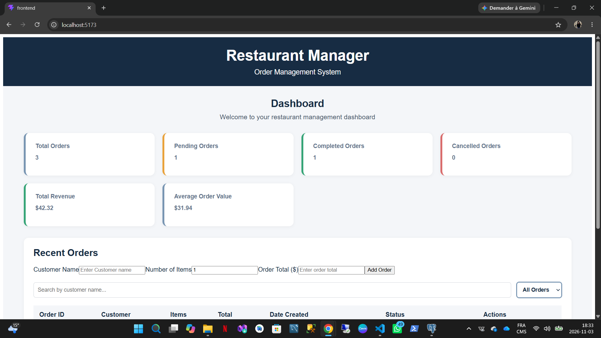
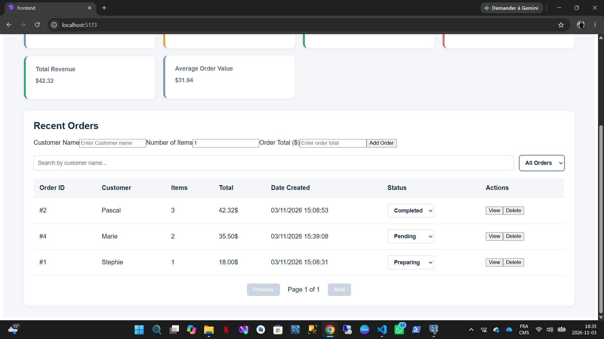
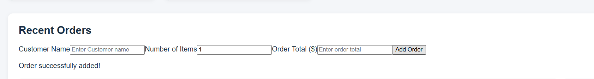
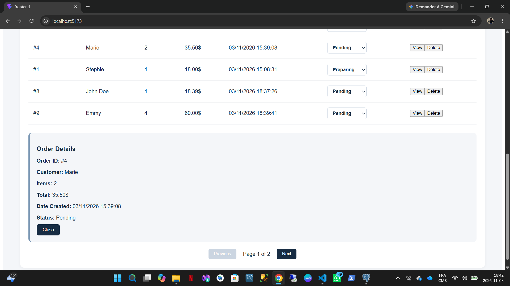
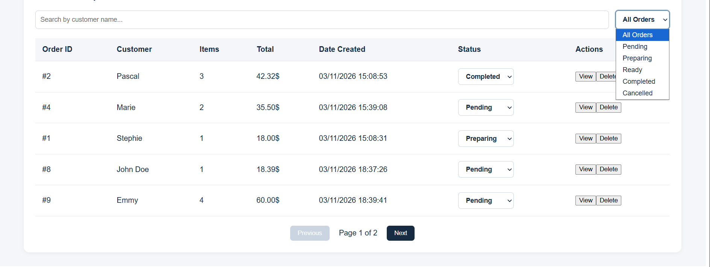

# Restaurant Order Management System

A full-stack web application for managing restaurant orders. This project allows users to create, view, update, and delete orders through a dashboard connected to a REST API and a PostgreSQL database.

## Features

- **Dashboard:** View order statistics, including total orders, pending orders, completed orders, cancelled orders, and revenue.
- **Order Management:** Create, retrieve, update, and delete restaurant orders.
- **Order Status Tracking:** Manage five order statuses: Pending, Preparing, Ready, Completed, and Cancelled.
- **Search and Filtering:** Find and filter orders.
- **Order Details:** View individual order information.
- **Data Validation:** Validate order information on the backend.
- **Error Handling:** Handle API errors and invalid requests.
- **Database Integration:** Persist order data using PostgreSQL.
## Screenshots

### 1. Dashboard

The dashboard provides an overview of restaurant activity, including total orders, pending orders, completed orders, cancelled orders, total revenue, and average order value.



### 2. Recent Orders

The orders table displays customer information, order totals, creation dates, and current order statuses. Users can search, filter, view, update, and delete orders.



### 3. Add a New Order

Users can create a new order by entering the customer's name, the number of items, and the order total.



### 4. Order Details

Users can view the details of an individual order directly from the dashboard.


### 3. Search Orders

Users can quickly find specific orders by searching for a customer's name. This makes it easier to locate and manage orders.



## Technologies Used

### Frontend
- React
- JavaScript
- Vite
- Axios
- CSS

### Backend
- Java 21
- Spring Boot 4
- Spring Data JPA
- Spring Web MVC
- Spring Validation
- Maven

### Database
- PostgreSQL

### Testing
- JUnit 5
- Mockito
- Spring MVC Test

## Project Structure

```text
restaurant-order-management-system/
├── backend/
│   ├── src/
│   │   ├── main/
│   │   │   ├── java/com/restaurant/backend/
│   │   │   │   ├── controller/
│   │   │   │   ├── entity/
│   │   │   │   ├── exception/
│   │   │   │   ├── repository/
│   │   │   │   └── service/
│   │   │   └── resources/
│   │   └── test/
│   └── pom.xml
│
├── frontend/
│   ├── src/
│   │   ├── components/
│   │   ├── services/
│   │   ├── App.jsx
│   │   └── App.css
│   └── package.json
│
└── README.md
```

## Getting Started

### Prerequisites

Make sure you have the following installed:

- Java 21
- Node.js and npm
- PostgreSQL
- Git

### 1. Clone the repository

```bash
git clone https://github.com/stephDurelle/restaurant-order-management-system.git
cd restaurant-order-management-system
```

### 2. Configure the database

Create a PostgreSQL database named:

```sql
CREATE DATABASE restaurant_db;
```

Configure your database connection in:

`backend/src/main/resources/application.properties`

Update the username, password, port, and database URL to match your local PostgreSQL configuration.

### 3. Run the backend

Open a terminal:

```bash
cd backend
```

Run the Spring Boot application:

```bash
./mvnw spring-boot:run
```

On Windows PowerShell, use:

```powershell
.\mvnw.cmd spring-boot:run
```

The backend runs at:

`http://localhost:8081`

### 4. Run the frontend

Open another terminal:

```bash
cd frontend
npm install
npm run dev
```

On Windows PowerShell, you can use:

```powershell
npm.cmd install
npm.cmd run dev
```

Open the application at:

`http://localhost:5173`

## API Endpoints

| Method | Endpoint | Description |
|---|---|---|
| GET | `/api/orders` | Retrieve all orders |
| GET | `/api/orders/{id}` | Retrieve an order by ID |
| POST | `/api/orders` | Create a new order |
| PUT | `/api/orders/{id}/status` | Update an order's status |
| DELETE | `/api/orders/{id}` | Delete an order |

## Running Tests

From the `backend` directory:

```powershell
.\mvnw.cmd test
```

The backend includes unit tests for the service layer and controller layer.

## Project Goals

This project was developed to strengthen practical full-stack development skills, including:

- Building RESTful APIs with Spring Boot.
- Developing interactive user interfaces with React.
- Connecting a frontend application to a backend API using Axios.
- Managing relational data with PostgreSQL and Spring Data JPA.
- Implementing validation and exception handling.
- Writing automated tests with JUnit and Mockito.

## Author

**Stephie Ngaleu**

GitHub: [@stephDurelle](https://github.com/stephDurelle)